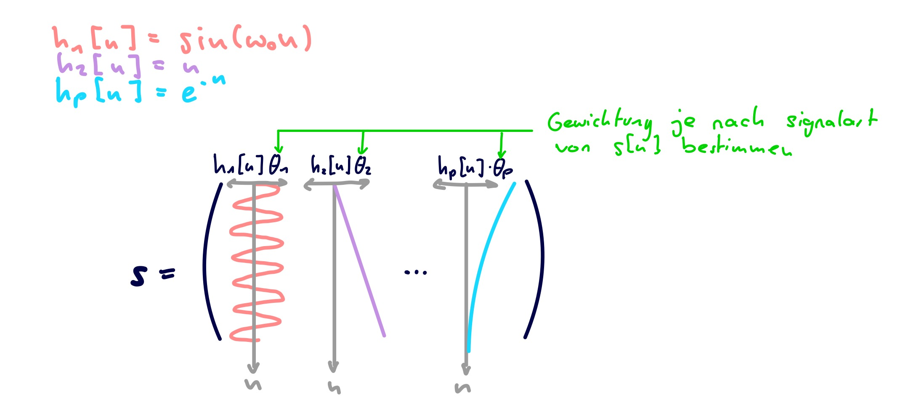

---
tags:
aliases:
  - Linear Least Squares
  - LLS
  - Normale Equations
subject:
  - SE
  - Bachelorarbeit
semester: SS26
created: 25th March 2026
professor:
release: false
title: Lineare Methode der kleinsten Quadrate
---

# Lineare Methode der kleinsten Quadrate

> [!question] [Methode der kleinsten Quadrate](Methode%20der%20kleinsten%20Quadrate.md)

Die Modellfunktion ist bei der LLS-Methode ein [Polynom](Algebra/Polynom.md) 1. Ordnung

$$
f(x) = w_{0} + w_{1} x
$$

Für eine gegebene Reihe  an $n$ Trainings- / Messdaten der

$$
\text{Eingänge: } (x_{1},\ldots,x_{n}) \qquad \text{Ausgänge: }(y_{1},\ldots,y_{n})
$$

werden die Koeffizienten $w_{1}, w_{2}$ gesucht, damit eine optimale Gerade die durch die Messdaten verläuft entsteht.

Zur optimierung werden nun die *Abweichungen / Anpassungsfehler* zur Modellfunktion

$$
e = f(x_{i})-y_{i}
$$

berechnet, also

$$
\begin{align}
e_{1} &= w_{1} + w_{2}x_{1} -y_{1} \\
e_{2} &= w_{1} + w_{2}x_{2} -y_{2} \\
&\vdots \\
e_{n} &= w_{1} + w_{2}x_{n} -y_{n}
\end{align}
$$
Oft werden die Parameter $w_{1}$ und $w_{1}$ auch zu einem Parametervektor $\mathbf{w}=\begin{pmatrix}w_{1} \\ w_{2}\end{pmatrix}$ zusammengefasst

> [!hint] $x$ und $y$ sind [Zufallsvariablen](Statistik/Zufallsvariable.md) bzw. Realisierungen eines [stochastischen Prozesses](Statistik/Stochastische%20Prozesse.md). Dabei ist $y$ eine *Abhängige Zufallsvariable* und zwar von der *unabhängigen Zufallsvariable* $x$
> 
> Dabei ist es Hier das Ziel, diese Abhängigkeit, mit einer Modellfunktion optimal abzuschätzen.

## Vektorparameterfall

Angenommen ein gemessenes Signal $\{ y[n] \}_{n=0}^{N-1}$ ist eine gestörte Version des unbekannten echten/untereligenden Signals $\{ s[n] \}_{n=0}^{N-1}$.

$$
\mathbf{s} = \begin{pmatrix}
s[0] \\ s[1] \\ \vdots \\ s[N-1]
\end{pmatrix} \qquad \mathbf{y} = \begin{pmatrix}
y[0] \\ y[1] \\ \vdots \\ y[N-1]
\end{pmatrix} = \mathbf{s} + \boldsymbol{\nu}
$$

- $\mathbf{s}$ ... Reines Signal
- $\mathbf{y}$ ... Messwerte
- $\boldsymbol{\nu}$ ... Rauschen

### Modell

Das Signal soll mit einem Linearen Modell dargestellt werden.

$$
s[n] = \sum_{k=1}^{P}w_{k}h_{k}[n]
$$

- $h_{k}[n]$ Modellfunktionen
- $w_{k}$ Parameter

Oder in Matrix Schreibweise

$$
\underbrace{ \begin{pmatrix}
s[0] \\ s[1] \\ \vdots \\ s[N-1]
\end{pmatrix} }_{ \mathbf{s} }
=
\underbrace{ \begin{pmatrix}
h_{1}[0] & h_{2}[0] & \ldots & h_{P}[0] \\
h_{1}[1] & h_{2}[1] & \ldots & h_{P}[1] \\
\vdots & \vdots & \ddots & \vdots \\
h_{1}[N-1] & h_{2}[N-1] & \ldots & h_{P}[N-1]
\end{pmatrix} }_{ \mathbf{H} }
\underbrace{ \begin{pmatrix}
w_{1} \\ w_{2} \\ \vdots \\ w_{P}
\end{pmatrix} }_{ \mathbf{w} }
$$

Das Signal $\mathbf{s}$ soll über ein lineares Modell $\mathbf{H}$ mit den unbekannten Modellparametern $\mathbf{w}$ dargestellt werden.

$$
\mathbf{s} = \mathbf{H}\mathbf{w}
$$

Dabei ist $\mathbf{H} \in \mathbb{R}^{N\times P}$ mit $N > P$ eine *bekannte Matrix*, welche [vollen Rang](Algebra/Rang%20einer%20Matrix.md) haben muss. Diese Matrix bezeichnet man als **Beobachtungsmatrix** oder **Design Matrix** (*en. observation Matrix*).

Die Messwerte $\mathbf{x}$ können dann als das Modell mit einem überlagerten rauschsignal $\boldsymbol{\nu}$ dargestellt werden

$$
\mathbf{y} = \mathbf{H}\mathbf{w}+\boldsymbol{\nu}
$$

> [!info] **Fazit**
> - $h_{k}[n]$ ... ist eine reihe von funktionen
> - Das Signal soll durch eine gewichtete summe der Modellfunktionen (z.b. Polynomen oder Trig. funktionen) abgeschätzt werden.

### Design Matrix

Die Design-Matrix besteht aus $N$ Zeilenvektoren von funktionen $(h_{k}[n])_{k=0}^{P}$, welche die Form des Modells Festlegen.

> [!hint]- **Fehler durch Modellungenauigkeit:** Das Modell kann die Daten nur Akkurat annähern wann eine der Modellfunktionen Ähnlich zum Echten Modell ist.
> z.B: Enthält das Echte Modell Einen Sinus Term, Wird der Parameter $w$ welches die Funktion $h[n] = \sin(n)$ gewichtet größer sein. Ist jedoch kein Sinus in den Modell Funktionen vorhanden, wird versucht der Sinus durch die Anderen Funktionen Angenähert zuu werden. Das kann in grenzfällen Schief gehen: bei einem Linearen Modell würde dann z.B. die Gerade konstant beim Mittelwert null gelegt werden.

> [!example]- Typische Formen von $\mathbf{H}$ sind z.B.
> 
> #### Gerade
> 
> $$
> s[n] = w_{1} + w_{2}n \implies h_{1}[n] = 1, h_{2}[n] = n
> $$
> 
> $$
> \mathbf{H} = \begin{pmatrix}
> 1 & 0 \\ 1 & 1 \\ 1 & 2 \\ \vdots & \vdots \\ 1 & N-1
> \end{pmatrix}
> $$
> 
> #### Polynome im Allgemeinen
> 
> $$
> s[n] = \sum_{k=1}^{P} w_{k}n^{k-1} = w_{1} + w_{2}n + w_{3}n^{2} \dots \implies h_{k}[n] = n^{k-1}
> $$
> 
> $$
> \mathbf{H} = \begin{pmatrix}
> 1 & 0 & 0 & \ldots & 0 \\
> 1 & 1 & 1 & \ldots & 1 \\
> 1 & 2 & 4 & \ldots & 2^{P} \\
> 1 & 3 & 9 & \ldots & 3^{P} \\
> \vdots &\vdots & \vdots & \ddots & \vdots \\
> 1 & N-1 & (N-1)^{2} & \ldots & (N-1)^{P} \\
> \end{pmatrix}
> $$
> 
> - Mit $0^{0} := 1$
> 
> 
> #### Trigonometrische Funktionen
> 
> Das Lineare Modell liefert die [Fourierreihe](../Systemtheorie/Zeitkontinuierlich/Fourierreihe.md) des Signals. Mit den Parametern werden dann die Spektralanteile abgeschätzt.
> 
> $$
> \begin{align}
> s[n] &= \sum_{k=1}^{P} \alpha_{k}\sin(k\omega_{0}n) + \beta_{k}\cos(k\omega_{0}n) \\
> \implies \mathbf{h}_{k}[n] &= \begin{pmatrix}
> \sin(k\omega_{0}n) & \cos(k\omega_{0}n)
> \end{pmatrix}, \quad \mathbf{w}_{k}
> =\begin{pmatrix}
> \alpha_{k} \\ \beta_{k}
> \end{pmatrix}
> \end{align}
> $$
> 
> 
> - $l:=N-1$
> 
> $$
> \mathbf{H} = \begin{pmatrix}
> 0 & 1 & 0 & 1 & \ldots & 0 & 1 \\
> \sin(\omega_{0}) & \cos(\omega_{0}) & \sin(2\omega_{0}) & \cos(2\omega_{0}) & \ldots & \sin(P\omega_{0}) & \cos (P\omega_{0}) \\
> \sin(2\omega_{0}) & \cos(2\omega_{0}) & \sin(4\omega_{0}) & \cos(4\omega_{0}) & \ldots & \sin(2P\omega_{0}) & \cos (2P\omega_{0}) \\
> \vdots & \vdots & \vdots & \vdots & \ddots & \vdots & \vdots  \\
> \sin(l\omega_{0}) & \cos(l\omega_{0}) & \sin(2l\omega_{0}) & \cos(2l\omega_{0}) & \ldots & \sin(Pl\omega_{0}) & \cos (Pl\omega_{0}) \\
> \end{pmatrix}
> $$

### Kostenfunktion und Lösung

Als Kostenfunktion wird die Summe der Fehlerquadrate verwendet um die Modellparameter zu schätzen.

- Mit den Messungen $\mathbf{y}$ ist die Summe der Fehlerquadrate als Kostenfunktion:

$$
\begin{align}
J(\mathbf{w}) & =\sum_{n=0}^{N-1}(y[n]-\hat{s}[n ; \hat{\mathbf{w}}])^2  \\
&=\sum_{n=0}^{N-1}(y[n]-\mathbf{h}_{n}^T \hat{\mathbf{w}})^2  \\
&=\sum_{n=0}^{N-1} e^2[n] =\mathbf{e}^T \mathbf{e} \\
&=(\mathbf{y}-\mathbf{H} \hat{\mathbf{w}})^T(\mathbf{y}-\mathbf{H} \hat{\mathbf{w}})
\end{align}
$$

- Das Minimum der Kostenfunktion ($J$ ist immer skalar) lässt sich durch den [Gradienten Abstieg](../Systemtheorie/Signalverarbeitung/Gradient%20Descent.md) ermitteln.
- Dieser Liefert im Linearen Fall die [Normalgleichungen](Normalgleichungen.md) $(\mathbf{H}^{T}\mathbf{H})\hat{\mathbf{w}} = \mathbf{H}^{T}\mathbf{y}$ und folglich:

$$
\begin{aligned}
\hat{\mathbf{w}} &= \left(\mathbf{H}^T \mathbf{H}\right)^{-1} \mathbf{H}^T \mathbf{y}, \\
\hat{\mathbf{s}} &= \mathbf{H} \hat{\mathbf{w}} = \mathbf{H}\left(\mathbf{H}^T \mathbf{H}\right)^{-1} \mathbf{H}^T \mathbf{y}
\end{aligned}
$$

- $(\mathbf{H}^T\mathbf{H})^{-1}\mathbf{H}^T$ wird auch als *pseudo-inverse* von $\mathbf{H}$ betzeichnet

# Referenzen

- [Lineare Modellfunktionen für LLS - Wikipedia](https://de.wikipedia.org/wiki/Methode_der_kleinsten_Quadrate#Lineare_Modellfunktion)
- [Normal Equations - Wolfram](https://mathworld.wolfram.com/NormalEquation.html)
